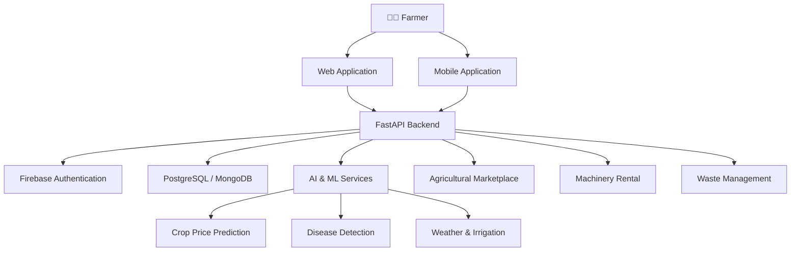

<!-- ================= HEADER ================= -->

<div align="center">


<a href="https://git.io/typing-svg">

</a>

<br/>


<br/><br/>

**🌾 Empowering Farmers | 🤖 Artificial Intelligence | 🌍 Sustainable Agriculture**

</div>

---

## 🌱 About PasumaiAI

**PasumaiAI** is an intelligent, AI-powered smart agriculture platform designed to transform traditional farming into a technology-driven ecosystem.

The platform integrates Artificial Intelligence, Machine Learning, Deep Learning, and modern web and mobile technologies to help farmers make smarter agricultural decisions.

From identifying crop diseases and predicting market prices to monitoring weather conditions and accessing agricultural marketplaces, PasumaiAI brings essential farming solutions together in one unified platform.

Our mission is to empower farmers with intelligent tools, improve agricultural productivity, minimize crop losses, and promote sustainable farming practices.

---

## 🚀 Key Features

<table>
<tr>
<td width="50%">

### 🌾 Crop Information
- Detailed crop information.
- Cultivation guidance.
- Crop requirements.
- Agricultural knowledge.

</td>
<td width="50%">

### 🤖 AI Disease Detection
- Upload crop leaf images.
- Deep learning-based analysis.
- Disease identification.
- Preventive recommendations.

</td>
</tr>

<tr>
<td width="50%">

### 📈 Crop Price Prediction
- Machine learning predictions.
- Historical price analysis.
- Market trend estimation.
- Better selling decisions.

</td>
<td width="50%">

### 🌦️ Weather Monitoring
- Weather information.
- Temperature monitoring.
- Rainfall updates.
- Weather-based farming decisions.

</td>
</tr>

<tr>
<td width="50%">

### 💧 Smart Irrigation
- Irrigation recommendations.
- Water management.
- Farming notifications.
- Efficient resource utilization.

</td>
<td width="50%">

### 🛒 Farmer Marketplace
- Sell homegrown products.
- Digital product listings.
- Connect farmers and buyers.
- Agricultural product marketplace.

</td>
</tr>

<tr>
<td width="50%">

### 🚜 Machinery Rental
- Agricultural equipment listings.
- Machinery rental services.
- Access farming resources.
- Reduce equipment costs.

</td>
<td width="50%">

### ♻️ Smart Waste Management
- Agricultural waste utilization.
- Sustainable farming practices.
- Resource management.
- Waste reduction.

</td>
</tr>
</table>

---

## 🛠️ Tech Stack

<div align="center">

### 💻 Frontend Development


### ⚙️ Backend Development


### 🗄️ Database & Authentication


### 🧠 AI / Machine Learning


### 🔧 Tools & Development


</div>

---

## 🧠 AI & Machine Learning Models

PasumaiAI integrates intelligent models to provide data-driven agricultural solutions.

| Model | Technology | Function |
|---|---|---|
| Crop Price Prediction | Scikit-learn | Predicts estimated agricultural market prices |
| Crop Disease Detection | TensorFlow / Keras | Identifies possible crop diseases from leaf images |

**Model Files:**

- `price_model.pkl` – Trained crop price prediction model.
- `leaf_disease_model.h5` – Trained crop disease detection model.

---

## 🏗️ System Architecture



---

## 🔄 How It Works

<div align="center">

| Step | Process |
|:---:|---|
| 01 | 👤 Farmer registers and logs into the platform |
| 02 | 📱 Accesses the agricultural dashboard |
| 03 | 📷 Uploads crop images or enters agricultural details |
| 04 | 🤖 AI models process the provided information |
| 05 | 📊 Receives predictions and intelligent insights |
| 06 | 🌱 Uses the recommendations for better farming decisions |

</div>

---

## 📂 Project Structure

```text
PasumaiAI/
│
├── frontend/
│   ├── web/
│   └── mobile/
│
├── backend/
│   ├── routes/
│   ├── models/
│   ├── services/
│   ├── database/
│   └── main.py
│
├── ml_models/
│   ├── price_model.pkl
│   └── leaf_disease_model.h5
│
├── docs/
│
├── .gitignore
└── README.md
```

*Note: This represents the suggested high-level structure. Update it to match your actual repository.*

---

## ⚡ Getting Started

### 1️⃣ Clone the Repository

```bash
git clone YOUR_REPOSITORY_URL
cd PasumaiAI
```

### 2️⃣ Frontend Setup

```bash
cd frontend/web
npm install
npm run dev
```

### 3️⃣ Backend Setup

```bash
cd backend

python -m venv venv

venv\Scripts\activate

pip install -r requirements.txt

uvicorn main:app --reload
```

### 4️⃣ Environment Variables

Create a `.env` file in the appropriate backend directory.

```env
DATABASE_URL=your_database_url
MONGODB_URI=your_mongodb_uri
WEATHER_API_KEY=your_weather_api_key
```

Configure Firebase credentials separately according to your application setup.

**Note:** Never upload API keys, passwords, or private credentials to GitHub.

---

## 🌍 Project Impact

<div align="center">

| 🌾 Agriculture | 🤖 Technology | 🌍 Sustainability |
|:---:|:---:|:---:|
| Better farming decisions | AI-powered predictions | Resource optimization |
| Reduced crop losses | Intelligent automation | Waste reduction |
| Market accessibility | Digital solutions | Sustainable practices |

</div>

---

## 🔮 Future Enhancements

- [ ] IoT-based real-time soil monitoring.
- [ ] GPS-based precision farming.
- [ ] AI-powered agricultural chatbot.
- [ ] Multilingual voice assistance.
- [ ] Satellite-based crop monitoring.
- [ ] Advanced crop yield prediction.
- [ ] Additional agricultural market integrations.

---

## 👨‍💻 Developed With ❤️

<div align="center">

**PasumaiAI – Smart Technology for a Greener Tomorrow**

🌱 *Growing Innovation, Empowering Farmers, Transforming Agriculture.*


</div>
