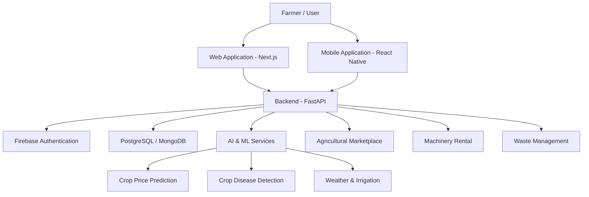

# 🌱 PasumaiAI – Intelligent Smart Agriculture Platform

<p align="center">
  <b>Empowering Farmers Through Artificial Intelligence, Machine Learning and Smart Technology</b>
</p>

## 📌 Overview

**PasumaiAI** is an AI-powered smart agriculture platform designed to support farmers by integrating Artificial Intelligence, Machine Learning, weather intelligence, and digital marketplaces into a unified ecosystem.

Traditional farming often faces challenges such as unpredictable weather, crop diseases, fluctuating market prices, inefficient irrigation practices, and limited access to agricultural resources.

PasumaiAI addresses these challenges through intelligent digital solutions that help farmers make data-driven decisions, improve agricultural productivity, reduce crop losses, and increase profitability.

The platform provides a user-friendly web and mobile experience, enabling farmers to access essential agricultural services from a single application.

## 🎯 Objectives

- Improve agricultural productivity through intelligent technologies.
- Help farmers identify crop diseases at an early stage.
- Predict crop prices to support better selling decisions.
- Provide weather-based agricultural recommendations.
- Optimize irrigation and water management.
- Connect farmers directly with buyers.
- Provide access to agricultural machinery and equipment.
- Promote sustainable farming and smart waste management.

## ✨ Key Features

### 1. 🌾 Crop Information Management
- Provides detailed information about different crops.
- Displays crop requirements, growing conditions, and cultivation guidance.
- Helps farmers understand suitable crops for their agricultural conditions.
- Provides centralized access to agricultural information.

### 2. 🤖 AI-Based Crop Disease Detection
- Allows farmers to upload images of crop leaves.
- Uses a trained deep learning model to analyze uploaded images.
- Identifies potential crop diseases based on image patterns.
- Provides disease-related information and preventive recommendations.
- Helps farmers identify crop health issues at an early stage.

### 3. 📈 Crop Price Prediction
- Uses historical agricultural market data to predict crop prices.
- Applies machine learning techniques to identify price trends.
- Helps farmers estimate future market prices.
- Supports informed decisions about when to sell agricultural products.

### 4. 🌦️ Weather Prediction and Monitoring
- Provides weather information for agricultural locations.
- Displays important weather conditions such as temperature and rainfall.
- Helps farmers plan cultivation and harvesting activities.
- Supports better agricultural decisions based on weather conditions.

### 5. 💧 Smart Irrigation and Notifications
- Provides irrigation-related recommendations.
- Supports water-efficient farming practices.
- Generates notifications for important agricultural activities.
- Helps farmers manage irrigation schedules more effectively.

### 6. 🛒 Agricultural Marketplace
- Enables farmers to list and sell their homegrown agricultural products.
- Connects farmers directly with potential buyers.
- Supports digital product listings and marketplace interactions.
- Helps reduce dependency on traditional selling channels.

### 7. 🚜 Agricultural Machinery Rental
- Provides a platform for farmers to access agricultural equipment.
- Allows machinery owners to list available equipment.
- Helps farmers find and rent machinery when required.
- Reduces the need for every farmer to purchase expensive equipment.

### 8. ♻️ Smart Waste Management
- Encourages the effective utilization of agricultural waste.
- Promotes recycling and sustainable agricultural practices.
- Supports better agricultural resource management.
- Helps reduce unnecessary agricultural waste.

## 🛠️ Technology Stack

| Category | Technologies |
|---|---|
| Web Frontend | Next.js, React.js |
| Mobile Application | React Native |
| Styling | Tailwind CSS |
| Backend / API | Python, FastAPI |
| Database | PostgreSQL, MongoDB |
| Authentication | Firebase Authentication |
| Machine Learning | Python, Scikit-learn |
| Deep Learning | TensorFlow, Keras |
| Model Storage | Pickle (.pkl), HDF5 (.h5) |
| Development Tools | VS Code, Git, GitHub |

## 🧠 AI & Machine Learning Models

PasumaiAI integrates machine learning and deep learning models to provide intelligent agricultural solutions.

| Model | Purpose |
|---|---|
| `price_model.pkl` | Predicts agricultural crop prices |
| `leaf_disease_model.h5` | Identifies crop diseases using leaf images |

**Crop Price Prediction:**

The trained machine learning model processes relevant agricultural input data and generates estimated crop prices.

**Crop Disease Detection:**

The deep learning model analyzes uploaded leaf images and predicts the possible disease category.

## 🏗️ System Architecture

The platform follows a modular architecture that connects the frontend, backend, databases, authentication services, and machine learning models.



## 🔄 How the System Works

1. **User Registration:** Farmers register and log in through the application.
2. **Dashboard Access:** Users access agricultural services through a centralized dashboard.
3. **Data Input:** Farmers provide crop details, upload leaf images, or select their location.
4. **AI Processing:** The backend processes the requests and connects with the relevant machine learning models or external services.
5. **Result Generation:** The system generates predictions, disease identification results, weather information, and recommendations.
6. **Marketplace Interaction:** Farmers can explore agricultural products and machinery rental services.
7. **Decision Making:** Farmers use the generated insights to make better agricultural decisions.

## 📂 Project Structure

The following is a suggested high-level project structure. Adjust folder names according to the actual repository.

```text
PasumaiAI/
│
├── frontend/
│   ├── web/
│   │   ├── app/
│   │   ├── components/
│   │   ├── public/
│   │   └── package.json
│   │
│   └── mobile/
│       ├── src/
│       ├── assets/
│       └── package.json
│
├── backend/
│   ├── main.py
│   ├── routes/
│   ├── models/
│   ├── services/
│   ├── database/
│   └── requirements.txt
│
├── ml_models/
│   ├── price_model.pkl
│   └── leaf_disease_model.h5
│
├── docs/
│
├── .gitignore
└── README.md
```

## ⚙️ Installation and Setup

### Prerequisites

Make sure you have installed:

- Node.js and npm
- Python 3.10+
- Git
- MongoDB / PostgreSQL
- Firebase project configuration

### 1. Clone the Repository

```bash
git clone <YOUR_GITHUB_REPOSITORY_URL>
cd PasumaiAI
```

### 2. Frontend Setup

Navigate to your web frontend directory:

```bash
cd frontend/web
npm install
npm run dev
```

### 3. Backend Setup

Navigate to the backend directory:

```bash
cd backend
```

Create a virtual environment:

```bash
python -m venv venv
```

Activate the environment on Windows:

```bash
venv\Scripts\activate
```

Install dependencies:

```bash
pip install -r requirements.txt
```

Start the FastAPI server:

```bash
uvicorn main:app --reload
```

### 4. Environment Configuration

Create a `.env` file and configure the required credentials.

```env
DATABASE_URL=your_database_url
MONGODB_URI=your_mongodb_connection
FIREBASE_CONFIG=your_firebase_configuration
WEATHER_API_KEY=your_weather_api_key
```

Replace the example values with the actual configuration used by your application. Never commit API keys, passwords, or private credentials to GitHub.

## 🔐 Security Features

- User authentication through Firebase Authentication.
- Environment variables for sensitive configuration.
- Backend API-based communication.
- Database-based storage and management.
- Separation of frontend and backend responsibilities.

## 🌍 Benefits and Impact

- **For Farmers:** Better access to agricultural information and digital services.
- **For Productivity:** Supports improved crop management and farming decisions.
- **For Sustainability:** Encourages efficient resource utilization and waste management.
- **For Marketing:** Helps farmers connect with potential buyers.
- **For Technology Adoption:** Introduces AI and digital technologies into traditional agriculture.

## 🚀 Future Enhancements

- IoT-based real-time soil moisture monitoring.
- GPS-based precision farming recommendations.
- Advanced AI-powered agricultural chatbot.
- Multilingual voice assistance for farmers.
- Satellite-based crop monitoring.
- Advanced crop yield prediction.
- Integration with additional agricultural market platforms.

## 👨‍💻 Project Information

**Project Name:** PasumaiAI – Intelligent Smart Agriculture Platform

**Domain:** Agriculture, Artificial Intelligence, Machine Learning and Full-Stack Development

**Project Type:** Web and Mobile Application

**Primary Technologies:** React, Next.js, React Native, Python, FastAPI, PostgreSQL, MongoDB and TensorFlow.

## 🤝 Contribution

Contributions, suggestions, and improvements are welcome.

1. Fork the repository.
2. Create a new feature branch.
3. Implement your changes.
4. Commit your changes.
5. Push your branch.
6. Submit a pull request.

## 📜 License

This project is developed for educational and development purposes. Add an appropriate open-source license if you intend to distribute the project publicly.

---

<p align="center">
  <b>🌱 PasumaiAI – Smart Technology for a Greener Agricultural Future 🌾</b>
</p>
